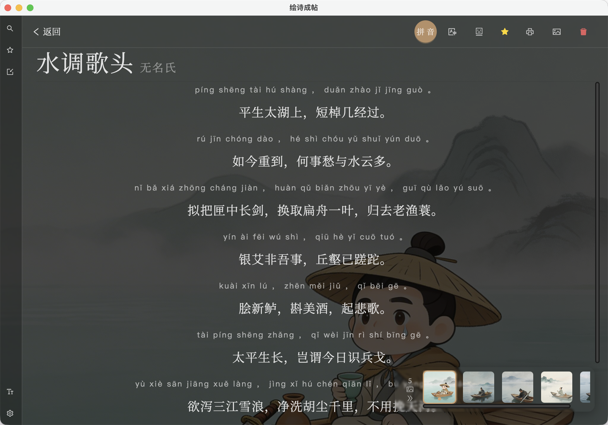
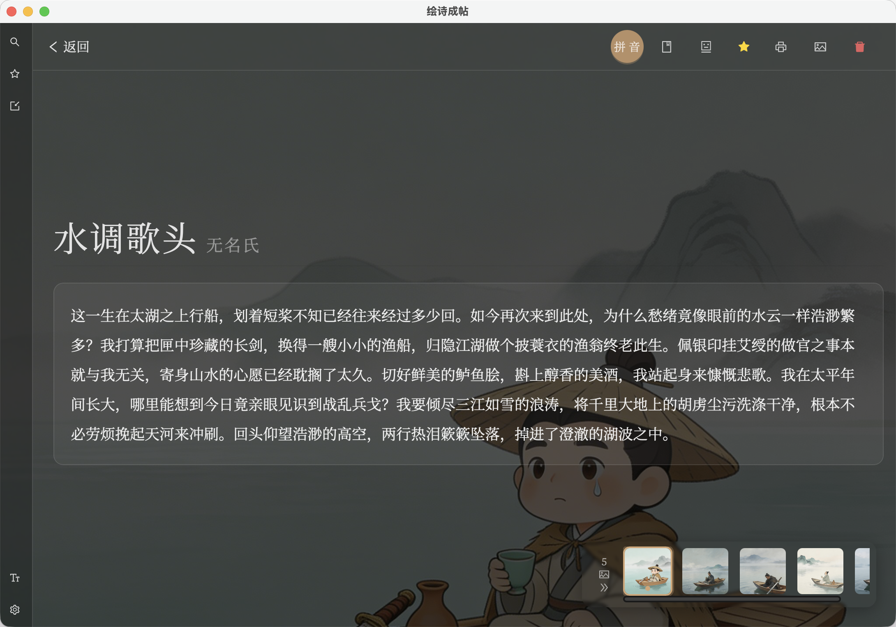
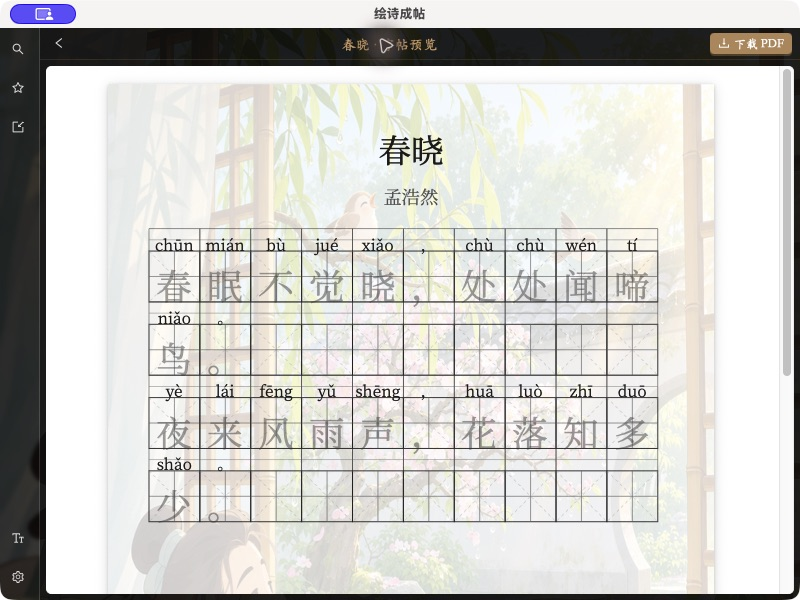
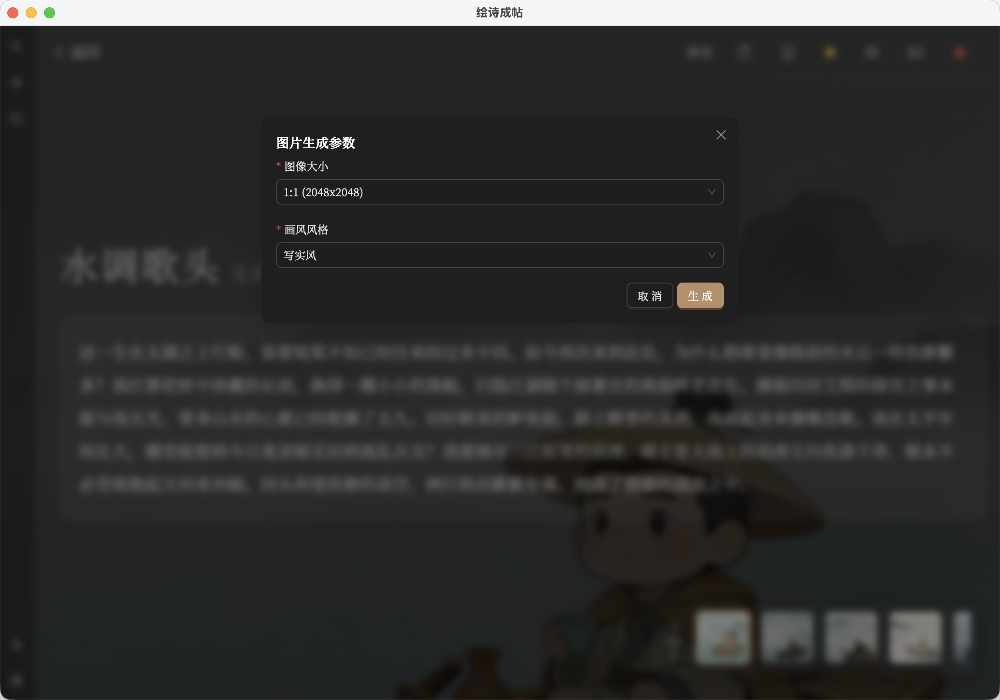
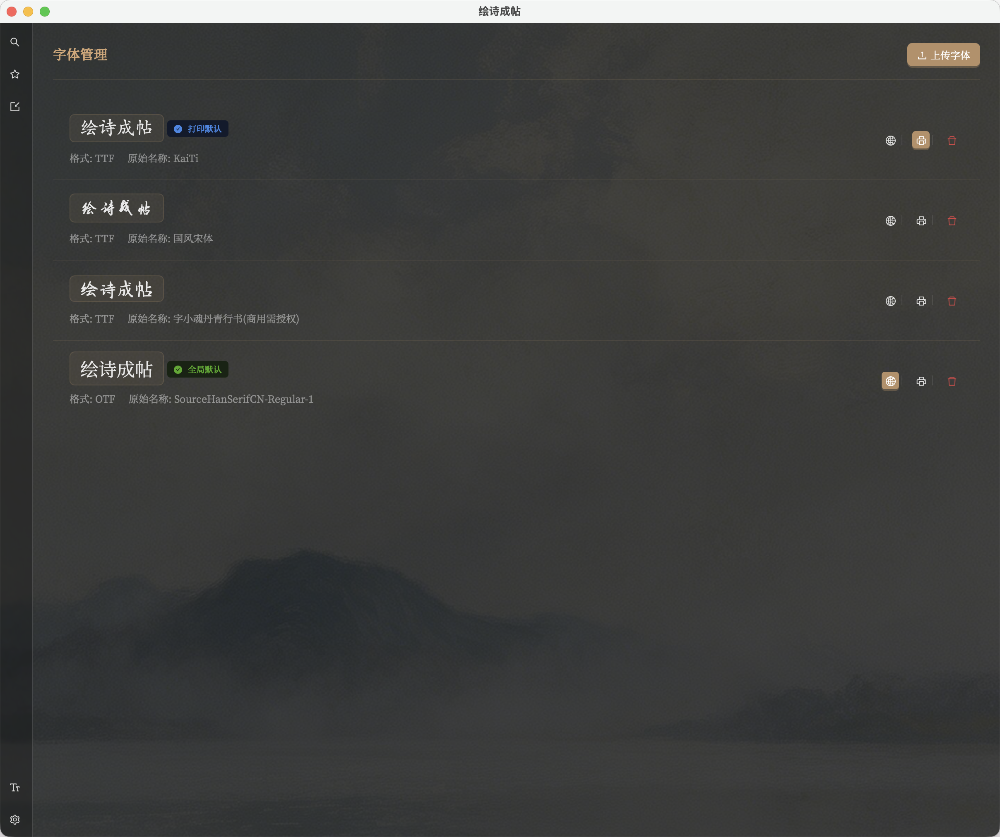
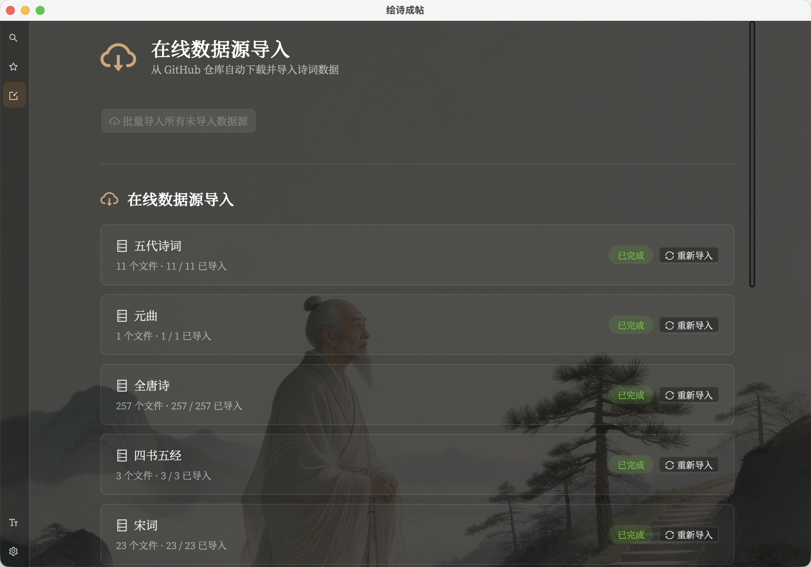

<p align="center">
  
</p>

<h1 align="center">PaintPoem / 绘诗成帖</h1>

<p align="center">
  <strong>把喜欢的古诗词变成可打印的练字 PDF</strong><br>
  Turn classical Chinese poetry into printable handwriting worksheets.
</p>

<p align="center">
  <a href="https://raw.githubusercontent.com/Cool-Star/PaintPoem/main/docs/examples/chunxiao.pdf"><strong>下载《春晓》样张 PDF</strong></a>
  ·
  <a href="https://github.com/Cool-Star/PaintPoem/releases/latest"><strong>下载安装包</strong></a>
  ·
  <a href="LICENSE">MIT 开源</a>
</p>

<p align="center">Windows x64 · macOS（Apple 芯片）· Linux x64</p>

<p align="center">
  
</p>

## 快速开始

1. 打开「导入数据」，选择数据源并导入诗词。
2. 回到首页搜索诗名，例如「春晓」，再打开诗词详情。
3. 点击「打印字帖」，选择临摹或练习模式，预览并下载 PDF。

如果 PaintPoem 帮你省下了排版时间，欢迎给项目点个 Star。

## 功能特性

- **诗词浏览** - 导入古典诗词后，可按诗名等关键词搜索
- **字帖生成** - 导出米字格字帖 PDF，支持临摹与练习两种模式
- **拼音支持** - 有拼音的诗词可在字帖中打印拼音，也可通过文字模型补充
- **AI 配图** - 集成 AI 绘画，为诗词生成意境配图
- **字体管理** - 支持自定义字体，内置思源宋体
- **收藏功能** - 收藏喜爱的诗词，建立个人诗单
- **数据导入** - 支持从 GitHub 数据源批量导入诗词

## 应用截图

### 首页与搜索
<p align="center">
  
</p>

### 诗词详情
<p align="center">
  
  
</p>

### 字帖预览
<p align="center">
  
</p>

### AI 智能配图
<p align="center">
  
</p>

### 字体管理
<p align="center">
  
</p>

### 收藏管理
<p align="center">
  
</p>

### 数据导入
<p align="center">
  
</p>

## 技术栈

- **前端**: React 19 + TypeScript + Ant Design 6
- **桌面框架**: Tauri 2 (Rust)
- **状态管理**: Redux Toolkit
- **PDF 生成**: PDFKit
- **数据库**: SQLite (Tauri Plugin)
- **构建工具**: Vite

## 安装

### 下载预编译版本

前往 [最新 Release](https://github.com/Cool-Star/PaintPoem/releases/latest) 下载对应平台的安装包。Windows x64 提供 EXE 和 MSI，Apple 芯片 Mac 使用 DMG，Linux x64 提供 AppImage、DEB 和 RPM。

### 从源码构建

环境要求

- Node.js 20.19+ 或 22.12+，CI 使用 Node.js 22。
- Rust 1.93.0，与 CI 使用的版本一致。
- pnpm 10.26.1，版本记录在 `package.json` 中。
- 按平台安装 [Tauri 2 构建依赖](https://v2.tauri.app/start/prerequisites/)。macOS 需要 Xcode Command Line Tools，Windows 需要 Visual Studio C++ Build Tools 和 WebView2，Linux 需要 WebKitGTK 4.1 等系统库。

```bash
# 克隆仓库
git clone https://github.com/Cool-Star/PaintPoem.git
cd PaintPoem

# 安装依赖
pnpm install --frozen-lockfile

# 开发模式
pnpm dev

# 检查类型并构建前端资源，输出到 dist/
pnpm build

# 构建当前系统的桌面安装包，按 Cargo.lock 锁定 Rust 依赖
pnpm build:desktop -- --locked
```

桌面安装包位于 `src-tauri/target/release/bundle/`。日常分支构建和 Pull Request 的 Linux、Windows 和 macOS 安装包可在 GitHub Actions 对应运行记录的 Artifacts 中下载。

### 发布新版本

1. 在 `package.json`、`src-tauri/tauri.conf.json` 和 `src-tauri/Cargo.toml` 中统一版本号，同步更新 `src-tauri/Cargo.lock`，并将版本变更合入 `main`。
2. 在 `main` 上的对应版本提交创建并推送新的 `vX.Y.Z` 标签。标签中的版本号必须与项目版本一致。
3. Linux、Windows 和 macOS 构建全部通过后，GitHub Actions 会自动创建公开 Release，生成发布说明并附上安装包。

## 使用指南

### AI 优化、翻译与配图

- 在「设置」中填写文本模型的 Base URL、模型名称和 API Key，可在保存前点击「测试连通性」。
- 在诗词详情的 AI 操作中，可选择重新优化或仅生成译文。译文支持自然通顺、正式典雅、幽默活泼、通俗易懂四种风格。重新优化以保存的原文为基础。
- 图像模型可使用 OpenAI 的 `https://api.openai.com/v1` 和账户可用的 GPT Image 模型，也可配置兼容服务。配图支持古典和卡通两种风格。已配置文本模型时会先生成画面描述，文本模型不可用时会用基础描述继续配图。

### 字体设置

1. 进入"字体管理"页面
2. 上传自定义字体文件(TTF/OTF)
3. 设置全局默认字体或打印专用字体

### 数据导入

1. 进入"导入数据"页面
2. 选择需要导入的数据源
3. 点击"批量导入所有未导入数据源"

## 项目结构

```
paint-poem/
├── src/                    # 前端源码
│   ├── components/         # React 组件
│   ├── pages/              # 页面组件
│   ├── services/           # 业务逻辑服务
│   ├── store/              # Redux 状态管理
│   ├── db/                 # 数据库操作
│   ├── datas/              # 数据源配置
│   └── types/              # TypeScript 类型定义
├── src-tauri/              # Tauri 后端
│   ├── src/                # Rust 源码
│   ├── icons/              # 应用图标
│   └── Cargo.toml          # Rust 依赖配置
├── public/                 # 静态资源
└── docs/                   # 字帖样张和应用截图
```

## 数据源

本项目诗词数据来源于以下开源项目：

- [chinese-poetry](https://github.com/chinese-poetry/chinese-poetry) - 中华古诗词数据库

## 许可证

项目代码采用 [MIT](LICENSE)。随安装包提供的思源宋体采用 [SIL Open Font License 1.1](src-tauri/third-party/SourceHanSerif-OFL.txt)。

## 致谢

- [Tauri](https://tauri.app/) - 跨平台桌面应用框架
- [Ant Design](https://ant.design/) - UI 组件库
- [PDFKit](http://pdfkit.org/) - PDF 生成库
